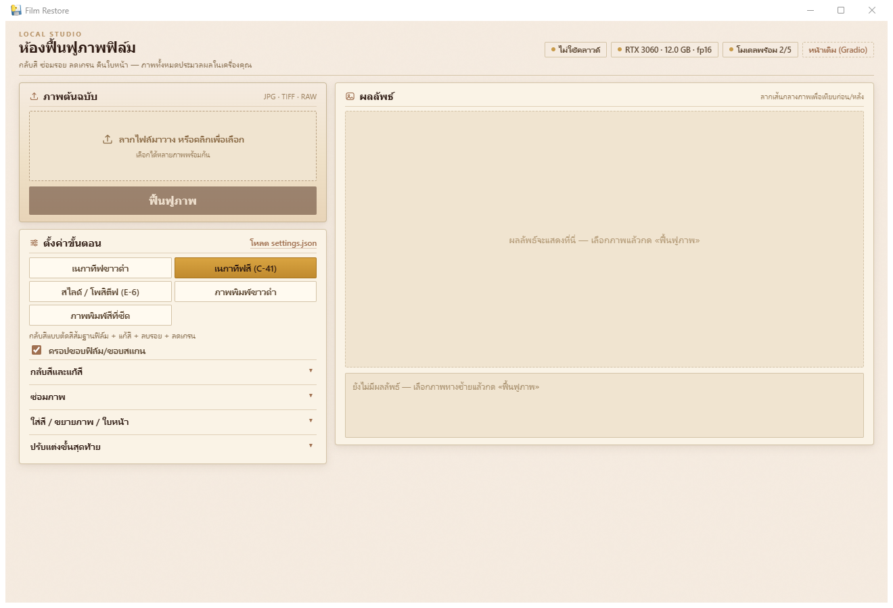
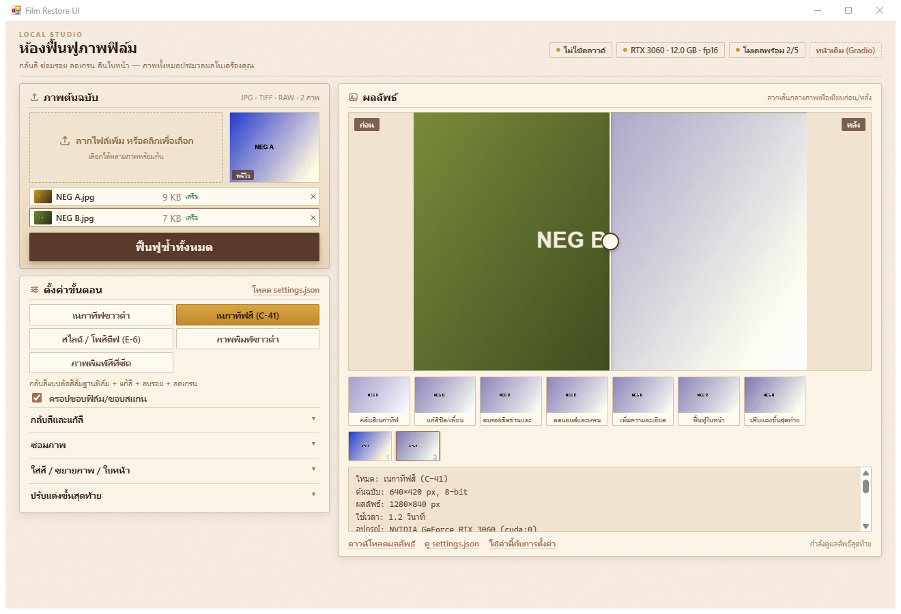

# Film Restore

ฟื้นฟูภาพจากฟิล์มและภาพพิมพ์เก่า: กลับสีเนกาทีฟ แก้สี ลบรอย ลดเกรน ใส่สี ขยายภาพ และฟื้นฟูใบหน้า
ประมวลผลบนเครื่องผู้ใช้ (GPU ถ้ามี, CPU แทนได้) — ดูแผนฉบับเต็มที่ [docs/Film_Restore.md](docs/Film_Restore.md)

## รัน

```bash
pip install -r requirements.txt
python backend/main.py            # เปิด http://localhost:7860  (หน้า React ที่ /, หน้าเดิม Gradio ที่ /classic)
python backend/main.py --host 0.0.0.0   # ให้มือถือในวง Wi-Fi เดียวกันเข้าได้
python desktop.py                 # โหมดหน้าต่างโปรแกรม (pywebview) — ถ้าพอร์ต 7860 ว่างอยู่ใช้พอร์ตเดิม ไม่งั้นเลือกพอร์ตว่างให้
```

> หน้า `/` เป็น React (ต้อง build `frontend/dist` ไว้ก่อน — ดูหัวข้อถัดไป) ถ้ายังไม่ build จะเสิร์ฟ Gradio ที่ `/` แทน

### แพ็กเป็น .exe (เฟส 4)

```bash
pyinstaller --noconfirm FilmRestore.spec     # ~5 นาที -> dist\FilmRestore\FilmRestore.exe
```

- เป็นแบบ **onedir**: ใช้ทั้งโฟลเดอร์ `dist\FilmRestore\` (~4.6 GB เพราะมี torch + CUDA) ย้ายทั้งโฟลเดอร์
  ไปเครื่องอื่นได้เลย ไม่ต้องติดตั้ง Python — ถ้าจะแจกจ่ายให้บีบอัดเป็น .zip หรือทำตัวติดตั้งภายหลัง
- **weights ไม่ได้ฝังใน .exe**: ดาวน์โหลดครั้งแรกตอนใช้จริง เก็บที่ `%LOCALAPPDATA%\FilmRestore\models`
  ผลลัพธ์แต่ละงานอยู่ที่ `%LOCALAPPDATA%\FilmRestore\outputs` และ log อยู่ที่ `%LOCALAPPDATA%\FilmRestore\film-restore.log`
  (เปลี่ยนที่เก็บด้วย env `FILM_RESTORE_DATA` หรือ `FILM_RESTORE_MODELS`)
- ไม่ได้ฝัง Real-ESRGAN / GFPGAN / modelscope (import ไม่ผ่านกับ torchvision รุ่นนี้) โปรแกรมจะถอยไปใช้
  Lanczos, ข้ามขั้นใส่สี และแจ้งเตือนในหน้าจอตามปกติ



ถ้าไม่มี GPU หรือยังไม่ติดตั้งโมเดล โปรแกรมยังใช้งานได้: ขั้นที่ต้องใช้โมเดลจะถูกข้าม
พร้อมแจ้งเตือนในหน้าจอ ส่วน upscale จะใช้ Lanczos แทน Real-ESRGAN

## หน้าเว็บ React (เฟส 3)

React + Vite ใน `frontend/` เป็น **หน้าหลักที่ `/`** ส่วน Gradio เดิมย้ายไปที่ **`/classic`**
ทั้งสองหน้าใช้ API/WebSocket ชุดเดียวกัน (`/api/*`, `/ws/restore`)

```bash
cd frontend
pnpm install
pnpm dev      # http://127.0.0.1:5175 (proxy /api, /files, /ws ไปที่ backend พอร์ต 7860)
pnpm build    # ได้ frontend/dist — backend เสิร์ฟที่ / ให้อัตโนมัติ
```



สิ่งที่หน้าหน้าใหม่ทำได้ (เหนือกว่า Gradio):

- **หลายภาพพร้อมกัน** — ลาก/เลือกได้หลายไฟล์ แล้วกดครั้งเดียว รันทีละภาพจนครบ
  มีแถบผลลัพธ์ด้านล่างไว้สลับดูทีละภาพ
- **พรีวิวสด** — เลื่อนสไลเดอร์ความแรง/เปลี่ยนโหมด แล้วภาพย่ออัปเดตตามทันที
  (ยิง `/api/preview` เฉพาะขั้นเบา ~90 ms ไม่แตะโมเดล AI)
- **โหลดค่าเดิมกลับมาแก้ต่อ** — ปุ่ม "โหลด settings.json" หรือ "ใช้ค่านี้กับการตั้งค่า" จากผลที่เพิ่งรัน
- สไลเดอร์เทียบก่อน/หลังแบบลากเส้น, ดูผลทีละขั้น, ดาวน์โหลดผล, เปิด `settings.json`

ถ้าโฟลเดอร์ `frontend/dist` ยังไม่มี ระบบจะข้าม mount นี้และเสิร์ฟ Gradio ที่ `/` แทน

## ส่วนประกอบ

| ไฟล์ | หน้าที่ |
|---|---|
| `backend/main.py` | FastAPI (`/api/health`, `/api/presets`, `/api/restore`, `/api/preview`) + เสิร์ฟหน้า React ที่ `/` และ Gradio ที่ `/classic` |
| `backend/ui.py` | หน้า Gradio (เดิม): เลือกโหมด, เปิด/ปิดแต่ละขั้น, สไลเดอร์เทียบก่อน/หลัง, ดูผลทีละขั้น |
| `frontend/` | หน้าเว็บ React + Vite (หน้าหลัก) — หลายภาพ, พรีวิวสด, โหลด settings.json |
| `backend/pipeline/engine.py` | ร้อยขั้นตาม preset, เก็บผลทุกขั้น, บันทึกคำเตือนเมื่อโมเดลไม่พร้อม |
| `backend/pipeline/film_invert.py` | กลับสีเนกาทีฟ + ตัดสีส้มฐานฟิล์ม (density = log10(base/img)) |
| `backend/pipeline/color_fix.py` | แก้สีซีด/เพี้ยน + ปรับแต่งขั้นสุดท้าย (white balance, contrast, เกรน) |
| `backend/pipeline/scratch.py` | ตรวจรอยด้วย top-hat/black-hat + ซ่อมด้วย LaMa หรือ OpenCV |
| `backend/pipeline/denoise.py` | ลดเกรนด้วย SCUNet (แบ่ง tile) — สำรองเป็น NLM + เติมรายละเอียดความถี่สูงกลับ |
| `backend/pipeline/colorize.py` | ใส่สีด้วย DDColor: ใส่สีบนภาพย่อแล้วขยาย chroma กลับทับ luma เดิม |
| `backend/pipeline/upscale.py` | Real-ESRGAN x2/x4 (สำรอง: Lanczos + unsharp) |
| `backend/pipeline/face.py` | CodeFormer + ตัวปรับ fidelity (สำรอง: GFPGAN v1.4) |
| `backend/pipeline/vendor/` | อาร์คิเทกเจอร์ CodeFormer/SCUNet ที่ vendor มาจากต้นทาง (Apache-2.0) |
| `backend/tools/evaluate.py` | วัด PSNR / SSIM / LPIPS / colorfulness บนชุดทดสอบตายตัว |
| `backend/tools/make_testset.py` | ดาวน์โหลดชุดอ้างอิง + สร้างภาพเสียจำลองแบบ fixed seed |
| `backend/core/gpu.py` | ตรวจ VRAM แล้วเลือก fp16 / ขนาด tile / เปิดปิด Diffusion |
| `backend/core/model_manager.py` | ดาวน์โหลด weights ครั้งแรก, lazy load, ใช้ไฟล์ในเครื่องได้ถ้ามีอยู่แล้ว |
| `backend/core/paths.py` | เลือกโฟลเดอร์เก็บข้อมูล: โหมดซอร์สใช้ในโปรเจกต์, โหมด .exe ใช้ `%LOCALAPPDATA%\FilmRestore` |
| `desktop.py` | เปิดเป็นหน้าต่างโปรแกรม (pywebview) + เขียน log เมื่อรันจาก .exe |
| `FilmRestore.spec` | ค่าตั้งของ PyInstaller สำหรับแพ็กเป็น .exe (onedir) |

weights เก็บที่ `backend/models/` ตอนรันจากซอร์ส (ไม่อยู่ใน git) — วางไฟล์ `.pth` เองได้ถ้าดาวน์โหลดช้า
เปลี่ยนโฟลเดอร์ด้วย env `FILM_RESTORE_MODELS` โหมด .exe ใช้ `%LOCALAPPDATA%\FilmRestore\models`

## API

```bash
curl http://localhost:7860/api/health

curl -X POST http://localhost:7860/api/restore \
  -F "file=@scan.jpg" \
  -F "preset=color_negative" \
  -F 'overrides={"denoise":0.4,"upscale":2,"face":null}' \
  -F "crop_border=true"

# พรีวิวเร็ว ๆ บนภาพย่อ (เฉพาะขั้นเบา ไม่โหลดโมเดล) — คืนไฟล์ JPEG
curl -X POST http://localhost:7860/api/preview \
  -F "file=@scan.jpg" -F "preset=color_negative" \
  -F 'overrides={"color_fix_strength":0.8}' -o preview.jpg
```

ผลลัพธ์: URL ของภาพแต่ละขั้น + `settings.json` ที่บันทึกค่าที่ใช้กับภาพนั้น (ไว้กลับมาแก้ภายหลัง)
ไฟล์อยู่ใน `backend/outputs/<job>/`

### WebSocket (สตรีมความคืบหน้า)

`ws://localhost:7860/ws/restore` — client ส่ง text JSON (ตั้งค่า) ตามด้วย binary ภาพ
แล้วรับ event กลับเป็น JSON (ใช้ connection เดียวส่งหลายงานได้)

```js
const ws = new WebSocket("ws://localhost:7860/ws/restore");
ws.onopen = () => {
  ws.send(JSON.stringify({ preset: "color_negative", overrides: { face: null }, filename: "scan.jpg" }));
  ws.send(fileBytes);            // ArrayBuffer/Blob ของภาพ
};
ws.onmessage = (event) => {
  const msg = JSON.parse(event.data);
  if (msg.type === "progress") console.log(msg.progress, msg.message); // 0.0–1.0
  if (msg.type === "done")     console.log(msg.result_url, msg.stages);
  if (msg.type === "error")    console.warn(msg.detail);
};
```

## วัดคุณภาพ

สร้างชุดทดสอบตายตัว (24 ภาพจาก Kodak PhotoCD + ภาพเสียจำลองแบบ fixed seed):

```bash
python backend/tools/make_testset.py        # ได้ testset/ref, testset/faded/in, testset/negative/in
```

| ชุด | ภาพที่ใช้ | preset ที่เข้าคู่ |
|---|---|---|
| `testset/faded/in` | ภาพพิมพ์สีซีด + สีเพี้ยน + เกรน + รอยขีด | `faded_color` |
| `testset/negative/in` | เนกาทีฟสี (กลับสี + มาสก์ส้มฐานฟิล์ม) | `color_negative` |

วัดผล (จับคู่ไฟล์ด้วยชื่อ stem เดียวกัน):

```bash
python backend/tools/evaluate.py \
  --input testset/faded/in --reference testset/ref \
  --preset faded_color --out backend/outputs/eval/faded --lpips

# ค่าตั้งต้นก่อนฟื้นฟู (ไม่รัน pipeline) ไว้เทียบว่าดีขึ้นเท่าไร
python backend/tools/evaluate.py \
  --input testset/faded/in --reference testset/ref \
  --no-pipeline --out backend/outputs/eval/faded_input --lpips
```

ได้ `metrics.csv` (ต่อภาพ) และ `summary.json` (ค่าเฉลี่ย + ค่าที่ใช้) — LPIPS ต้อง `pip install lpips`
ผล baseline ปัจจุบันดูที่ [docs/Baseline.md](docs/Baseline.md) (รันซ้ำทุกครั้งที่แก้ pipeline แล้วเทียบตัวเลข)

## สถานะเทียบกับแผน

- **เฟส 1:** film_invert, color_fix, engine + presets, Gradio UI, ต่อ DDColor / Real-ESRGAN /
  CodeFormer (หลัก) + GFPGAN (สำรอง) เรียบร้อย — CodeFormer ใช้ไลเซนส์ NTU S-Lab 1.0 (ใช้ส่วนตัวได้)
- **เฟส 2:** scratch (ตรวจรอย + LaMa), denoise ด้วย SCUNet, gpu.py (VRAM/fp16/tiling) เรียบร้อย
- **เฟส 3:** Frontend React เรียบร้อย — เป็นหน้าหลักที่ `/` (Gradio เดิมอยู่ที่ `/classic`)
  มีหลายภาพพร้อมกัน, พรีวิวสดระหว่างปรับค่า, โหลด `settings.json` กลับมาแก้ต่อ,
  สไลเดอร์เทียบก่อน/หลัง, ดูผลทีละขั้น และ progress ผ่าน WebSocket
- **เฟส 4:** เดสก์ท็อปเรียบร้อย — `desktop.py` (pywebview) และแพ็กเป็น .exe ด้วย `FilmRestore.spec`
  (onedir, ทดสอบบน RTX 3060: เปิดโปรแกรม ~12 วิ, งานแรกมีดาวน์โหลด weights, งานถัดไปเร็วตามปกติ)
- **เฟส 5:** พู่กันระบุสี / Diffusion / fine-tune — ยังไม่ได้ทำ
- **เสริม:** WebSocket `/ws/restore` สำหรับสตรีมความคืบหน้า, `backend/tools/evaluate.py` วัด PSNR/SSIM/LPIPS
